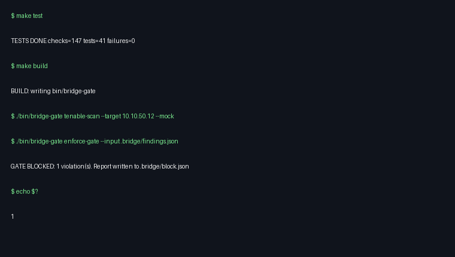

# bridge-gate

> **Status:** Active — maintained. Unofficial project, no affiliation with CyberArk/Tenable; synthetic fixtures only.

> **Enterprise IAM/PAM & Policy-as-Code automation component.**
> Enforces least-privilege access, automated compliance checks, and
> privileged session governance for cloud and enterprise directory platforms.

* **Target environment:** Enterprise hybrid / CyberArk Vault & Conjur /
  Active Directory / OPA (reference policy in `policies/mas_trm.rego`).
* **Regulatory focus:** MAS TRM / SG PDPA compliance-as-code
  (`policies/mas_trm.edn` is the enforced gate; the `.rego` is reference).
* **Core function:** Replaces manual privilege auditing and risky IAM drift
  with deterministic, version-controlled policy evaluation in CI.

**Enterprise Compliance-as-Code Engine** — a single, fast Common Lisp (SBCL) CLI
that orchestrates CyberArk dynamic credential fetching, triggers a targeted
Tenable scan, and runs a pure policy check before permitting a CI/CD
infrastructure deployment.

Current release: **v0.2.1** (see `VERSION`, `CHANGELOG.md`,
`lisp/bridge-gate.asd` `:version`). Zero-dependency Common Lisp (SBCL),
single-binary execution gate. No Quicklisp, no third-party Lisp libraries.

Legacy enterprise platforms have terrible CLI DX: CyberArk has a complex REST
API, Tenable outputs bloated JSON/XML, ServiceNow requires manual ticket
tracking. Security teams are forced to write 500-line fragile Bash scripts or
pay millions for heavy enterprise orchestrators. `bridge-gate` replaces that
glue with one standalone binary and a machine-enforced gate.

```
bridge-gate cyberark-auth  →  bridge-gate tenable-scan --target 10.10.50.12  →  bridge-gate enforce-gate
   short-lived creds              scan + normalized findings                     exit 0 PASS / 1 BLOCK / 2 ERROR
```



## Quickstart (offline, no credentials needed)

Requires SBCL 2.4+ and ASDF 3 (both standard). Zero Lisp dependencies: no
Quicklisp, no third-party libraries. Build and tests run offline.
Build once, then run the standalone binary:
```bash
make build
./bin/bridge-gate cyberark-auth --mock
./bin/bridge-gate tenable-scan --target 10.10.50.12 --mock
./bin/bridge-gate enforce-gate --input .bridge/findings.json
# mock findings contain 1 HIGH → BLOCK, exit 1, .bridge/block.json written
echo $?                         # 1 — pipeline halts
```

The shipped policy blocks the mock scan because it contains one `high` finding
(`max-highs` is `0`). Use `--report PATH` to change the block payload location.

## Build and source registry

`make build` is self-contained: `lisp/build.lisp` registers the local
`lisp/bridge-gate.asd` directly, so it works with `sbcl --no-userinit --script
lisp/build.lisp` even without a source registry. The registry entry below is only
needed if you invoke `asdf:test-system` or `asdf:load-system` directly.

ASDF finds this repository through the standard source registry. Create the
registry entry once, substituting the absolute path to this checkout:

```bash
mkdir -p ~/.config/common-lisp/source-registry.conf.d
cat > ~/.config/common-lisp/source-registry.conf.d/60-bridge-gate.conf <<'REG_EOF'
(:tree "/path/to/bridge-gate/lisp/")
REG_EOF
```

For a one-off shell (or CI), use the environment variable instead:

```bash
export CL_SOURCE_REGISTRY='(:source-registry (:tree "/path/to/bridge-gate/lisp/") :inherit-configuration)'
```

Then:

```bash
make build     # sbcl --no-userinit --script lisp/build.lisp → bin/bridge-gate
make test      # scripts/test.sh: self-contained suite, offline, zero network
make smoke     # binary smoke test (see scripts/verify.sh)
make verify    # test + build + smoke, the full fail-closed release gate
```

Both `lisp/build.lisp` and `scripts/test.sh` sanitize `XDG_DATA_DIRS` before ASDF
runs: ASDF builds its default source registry from that variable and aborts on
relative entries (e.g. `./share/`) injected by sandbox or mount environments.
Only absolute entries survive, so the gates behave identically on a laptop, in
CI, and inside a mounted desktop app.

`lisp/build.lisp` uses `sb-ext:save-lisp-and-die` with `:executable t`,
`:compression t`, and `:save-runtime-options t`. The last option keeps
SBCL's runtime option handling enabled in the saved image, so application flags such as
`--help` reach the bridge-gate entry point instead of being swallowed by the
SBCL runtime. Compression requires an SBCL runtime built with zstd support
(`--with-sb-core-compression`); if your SBCL lacks it, rebuild SBCL or remove
`:compression` locally. The resulting `bin/bridge-gate` is a self-contained
executable; no Lisp installation is needed at runtime.

### Dependencies

`:depends-on ()` — no Quicklisp, no ASDF-contributed systems, no local
dependencies outside `lisp/src/`.

| Library | Why |
|---|---|
| `uiop` (ships with ASDF/SBCL) | Portable pathnames, environment, subprocess I/O |
| `sb-ext` (SBCL) | `save-lisp-and-die` image dump only |
| `curl` (external binary, live only) | TLS-capable HTTP for live CyberArk/Tenable calls; tests inject mock clients and never invoke it |
| (test system only) | Minimal `deftest`/`testing`/`ok` harness in `lisp/test/support.lisp`; no external test framework |

## Commands

| Command | Purpose |
|---|---|
| `bridge-gate cyberark-auth` | Fetch short-lived credential via CyberArk CCP or Conjur; prints JSON |
| `bridge-gate tenable-scan --target IP` | Launch scan, poll to completion, save normalized findings JSON |
| `bridge-gate enforce-gate [--policy P] [--input F] [--report R]` | Evaluate findings; exit **0** PASS · **1** BLOCK (writes `block.json`) · **2** error |

Flags come after the subcommand. Common flags: `--mock` (offline fixtures, also
`BRIDGE_MOCK=true`), `--input -` (force stdin), `--out PATH`,
`--notify-webhook URL` (POST the Slack block payload on BLOCK), `--config PATH`,
`-h/--help`.

Exit codes are a contract:

* `0` gate passed (PASS)
* `1` policy violation (BLOCK, `block.json` written)
* `2` usage or execution error

```bash
# Compose in a pipeline: findings flow scan → gate over stdin
./bin/bridge-gate tenable-scan --target 10.10.50.12 --mock --out /tmp/f.json
cat /tmp/f.json | ./bin/bridge-gate enforce-gate --input -
```

## Configuration

Precedence: **defaults < `config.edn` < environment < CLI flags**. Copy
`config.edn.example` → `config.edn` (git-ignored). `config.edn` holds local
overrides; commit only `config.edn.example`. Environment and CLI override file
values; see `lisp/src/config.lisp` for the full key list.

| Backend | Select via | Needs |
|---|---|---|
| CyberArk CCP | `CYBERARK_MODE=ccp` | `CYBERARK_BASE_URL/APP_ID/SAFE/OBJECT` |
| CyberArk Conjur | `CYBERARK_MODE=conjur` | `CONJUR_APPLIANCE_URL/ACCOUNT/AUTHN_LOGIN/API_KEY/SECRET_VAR` |
| Tenable.io | `TENABLE_MODE=tenable-io` | `TENABLE_BASE_URL/ACCESS_KEY/SECRET_KEY` + `TENABLE_SCAN_ID` or `TENABLE_TEMPLATE_UUID` |
| Tenable.sc | `TENABLE_MODE=tenable-sc` | same base/keys + `TENABLE_SCAN_ID` |

## Policy

The gate evaluates an **EDN policy spec** with a pure Common Lisp engine
(`bridge-gate.policy`) — no `opa` binary. `policies/mas_trm.rego` documents the
same rules for Rego readers but is **reference only, never parsed**. Default
`policies/mas_trm.edn`:

```edn
{:rules {:max-criticals 0 :max-highs 0 :max-mediums 50
         :max-severity :high :blocked-plugins #{10001 20002}
         :required-fields [:host :plugin-id :severity]}}
```

On violation, `enforce-gate` writes a structured ServiceNow + Slack payload
(`BRIDGE_REPORT`, default `.bridge/block.json`) and exits 1.

## CI usage

```yaml
- run: make build
- run: ./bin/bridge-gate tenable-scan --target ${{ secrets.SCAN_TARGET }}
- run: ./bin/bridge-gate enforce-gate --policy policies/mas_trm.edn
```

The step fails (exit 1) exactly when policy is violated — the deploy job never runs.

## Architecture

```
CI/CD Pipeline ──invoke──▶ bridge-gate CLI (lisp/src/core.lisp dispatcher)
                              │ auth                    │ gates (exit code)
                              ▼                         ▼
                    lisp/src/cyberark.lisp ──creds──▶ CyberArk Vault (CCP/Conjur)
                              │ inject (credential)
                              ▼
                    lisp/src/tenable.lisp ──launch/poll/export──▶ Tenable (io / sc)
                              │ write findings.json
                              ▼
                    .bridge artifacts ──eval──▶ lisp/src/policy.lisp (pure EDN eval)
                                                     │ exit 0 PASS ──▶ CLI ──▶ CI deploys
                                                     │ BLOCK ──▶ ServiceNow + Slack payload
```

Modules: `bridge-gate.core` (dispatch, exit codes), `bridge-gate.config`
(defaults < file < env < CLI), `bridge-gate.cyberark` + `bridge-gate.tenable`
(injectable-HTTP connectors, mock-capable), `bridge-gate.policy` (pure
evaluation + block payloads), `bridge-gate.edn` (minimal EDN reader), and
`bridge-gate.json` (deterministic emitter). Data contracts: credential
`(:username :secret :expiry)`, scan
`(:scan-id :target :status :findings [(:host :plugin-id :name :severity :port)])`,
gate `(:passed? :violations :summary)`. Booleans are explicit: `t` → JSON
`true`, `:false` → JSON `false`, `nil` → JSON `null`, and `#()` → `[]`.

See `ARCHITECTURE.md` for the full component map, trust model, and data contracts.

## Development

```bash
make test      # 41 tests / 147 assertions, offline mock-based, must be green
make build
make smoke
make verify    # everything, in order — what CI runs
```

Layout: `lisp/bridge-gate.asd`, `lisp/build.lisp`, `lisp/src/*.lisp`,
`lisp/test/*-test.lisp`, `policies/{mas_trm.edn,mas_trm.rego}`.
The test gate treats compiler warnings as errors and forces a fresh compile so
cached fasls cannot hide a new warning:

```bash
XDG_DATA_DIRS="/usr/local/share:/usr/share" sbcl --no-userinit --non-interactive --disable-debugger \
     --eval '(require :asdf)' \
     --eval '(push (truename "lisp/") asdf:*central-registry*)' \
     --eval '(setf asdf:*compile-file-warnings-behaviour* :error)' \
     --eval '(asdf:test-system "bridge-gate")'
```

`make test` (via `scripts/test.sh`) runs exactly that, plus the `XDG_DATA_DIRS`
sanitization described above.

## License

MIT — see [LICENSE](LICENSE).
